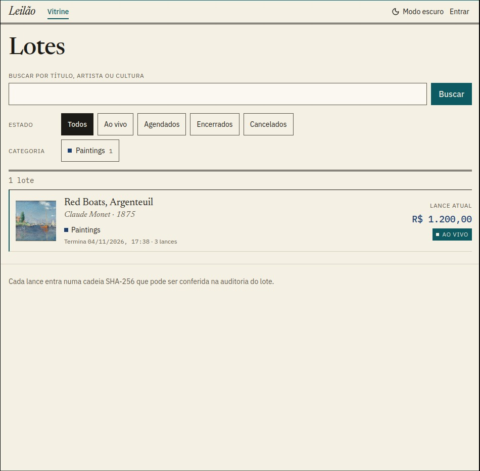
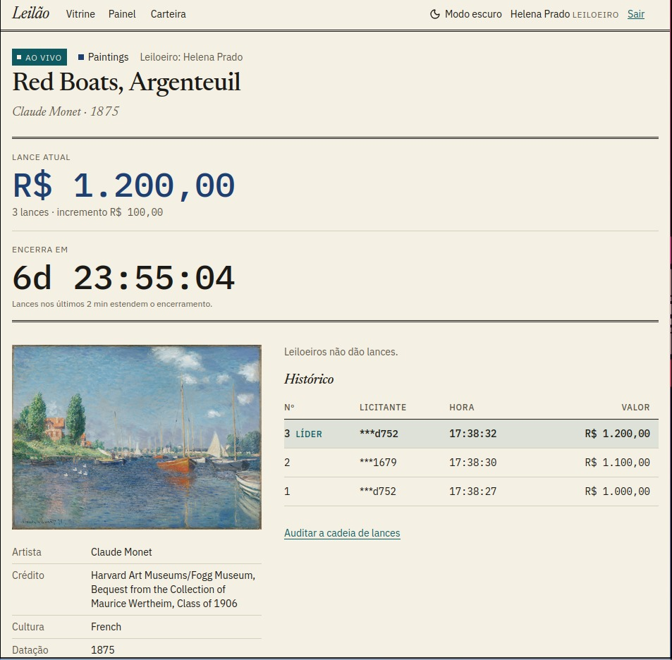
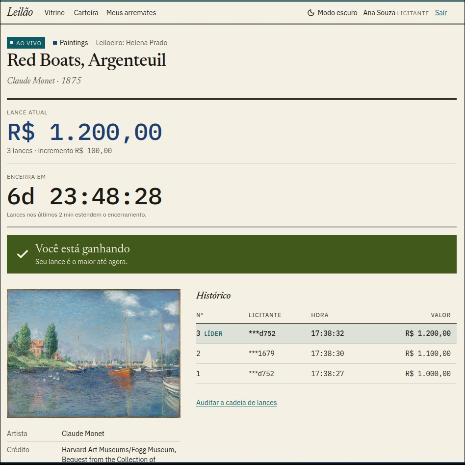
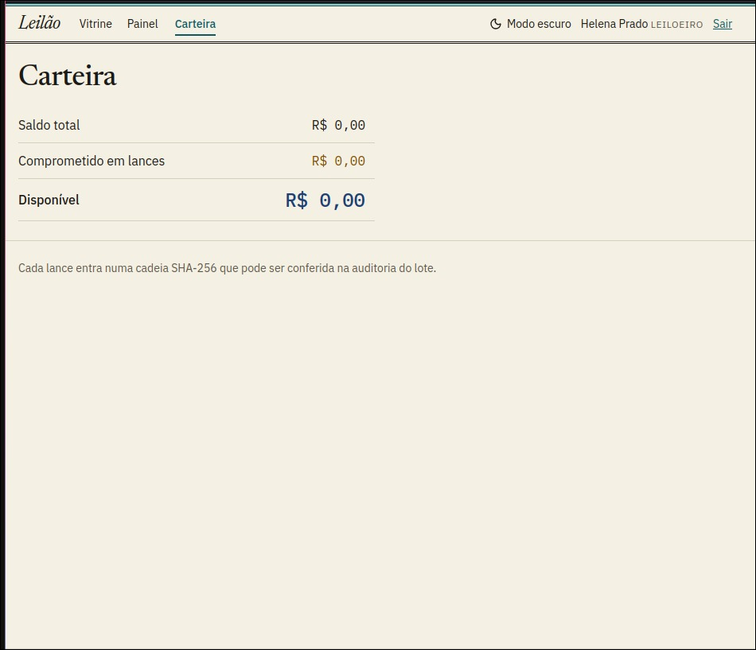
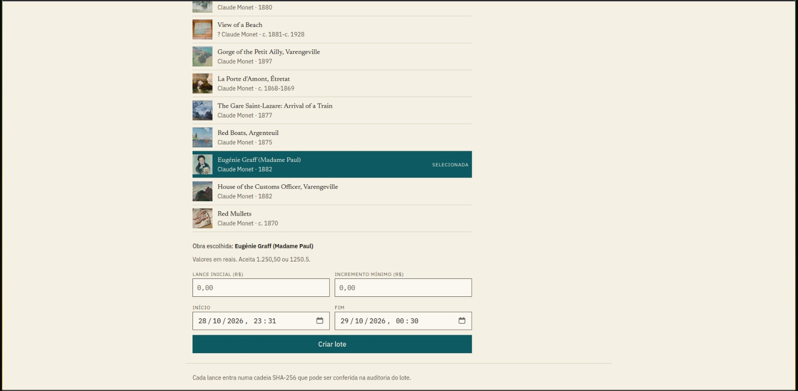
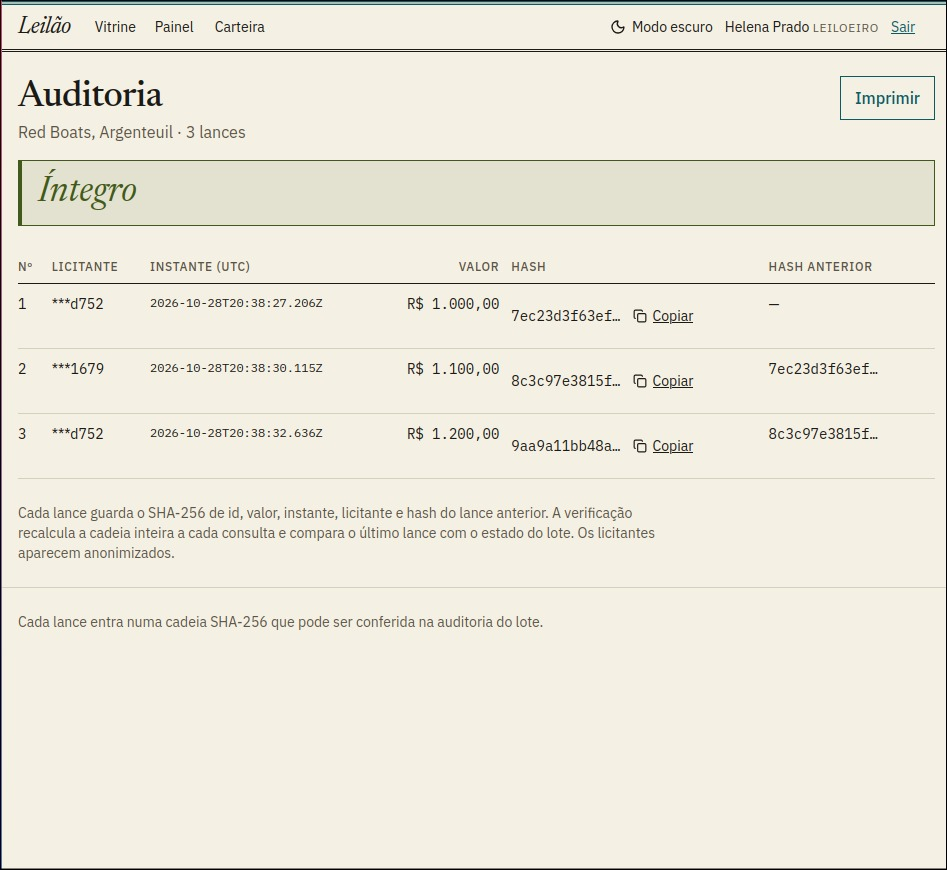

# Leilão

Casa de leilões online com lances em tempo real e auditoria pública por cadeia de hashes.

Leiloeiros criam lotes a partir do acervo do Harvard Art Museums, licitantes dão lances em tempo real e cada lance entra numa cadeia de hashes que qualquer pessoa pode auditar sem login.

Cada pasta tem o próprio README:

- [backend/README.md](backend/README.md): rotas, regras de negócio, concorrência, auditoria, testes e deploy
- [frontend/README.md](frontend/README.md): telas, sessão, tempo real e decisões de interface

## Índice

- [Capturas de tela](#capturas-de-tela)
- [Tecnologias](#tecnologias)
- [Funcionalidades](#funcionalidades)
- [Estrutura](#estrutura)
- [Variáveis de ambiente](#variáveis-de-ambiente)
- [Decisões de arquitetura](#decisões-de-arquitetura)
- [Hospedagem](#hospedagem)
- [Como rodar](#como-rodar)
- [Testes](#testes)
- [Contas do seed](#contas-do-seed)
- [Limites conhecidos](#limites-conhecidos)
- [FAQ](#faq)
- [Repositório](#repositório)

## Capturas de tela

**Vitrine**: busca por título, artista ou cultura, filtro por estado e por categoria.



**Sala ao vivo, visão do leiloeiro**: valor atual, contador, histórico com o líder marcado e dados da obra. O leiloeiro não dá lances.



**Sala ao vivo, visão do licitante líder**: o aviso "Você está ganhando" aparece sem recarregar a página.



**Carteira**: saldo total, comprometido em lances e disponível.



**Painel do leiloeiro, novo lote**: busca de obras na Harvard, escolha da obra e definição de lance inicial, incremento, início e fim.



**Auditoria pública**: selo Íntegro, licitantes anonimizados, hash de cada lance e hash do lance anterior.



## Tecnologias

- Front-end: Next.js (App Router), Tailwind CSS 4, socket.io-client, lucide-react
- Back-end: NestJS 12, Prisma 6, Socket.io, TypeScript
- Banco: PostgreSQL 16 (Neon em produção)
- API externa: Harvard Art Museums
- Testes: Vitest
- Hospedagem: Vercel (front), Render (back), Neon (banco)
- Docker Compose para o banco local

## Funcionalidades

- Lotes criados a partir de obras do Harvard Art Museums
- Vitrine com busca (título, artista, classificação e cultura), filtro por estado e por categoria
- Lances em tempo real via WebSocket, com aviso "Ganhando" ou "Superado"
- Saldo comprometido: o valor do lance fica bloqueado para o líder e volta quando ele é superado
- Anti-sniping: lance nos últimos 2 minutos soma 2 minutos ao fim do lote
- Liquidação automática dos lotes vencidos
- Comprovante anonimizado e auditoria pública da cadeia de lances (selo Íntegro ou Adulterado)
- Cópia dos hashes, impressão do comprovante e da auditoria, tema claro e escuro

## Estrutura

```
.
├── docker-compose.yml   banco PostgreSQL
├── backend/             API NestJS, WebSocket, liquidação, auditoria
└── frontend/            Next.js
```

## Variáveis de ambiente

| Onde | Variável | Uso |
|---|---|---|
| backend | `DATABASE_URL` | Conexão com o PostgreSQL |
| backend | `JWT_SECRET` | Segredo de assinatura dos tokens |
| backend | `HARVARD_API_KEY` | Chave da Harvard Art Museums |
| backend | `FRONTEND_URL` | Origem(ns) permitida(s) no CORS, separadas por vírgula, sem barra final. Padrão: `http://localhost:3000` |
| backend | `PORT` | Porta da API. Padrão: `3001` |
| frontend | `NEXT_PUBLIC_API_URL` | Endereço da API. Padrão: `http://localhost:3001` |

Cada aplicação tem o próprio `.env.example`. Os arquivos `.env` não são versionados. `NEXT_PUBLIC_API_URL` é gravada no build do front: ao mudar, faça novo build ou redeploy.

## Decisões de arquitetura

**Resiliência da API externa.** Ao criar um lote, título, URL da imagem e atributos da obra são copiados para o banco. Vitrine, sala, auditoria e comprovante leem só do PostgreSQL. Se a Harvard cair, apenas a criação de lotes novos fica indisponível.

**Motor de lances.** Cada lance roda em uma transação com `SELECT ... FOR UPDATE` no lote e, depois, nas carteiras envolvidas em ordem de id. O lock do lote serializa lances concorrentes, e a ordem fixa nas carteiras evita deadlock. O evento em tempo real só sai depois do commit.

**Saldo comprometido.** `disponível = total - comprometido`. O líder tem o valor do lance bloqueado, e o bloqueio volta no instante em que ele é superado.

**Anti-sniping.** Lance aceito nos últimos 2 minutos soma 2 minutos ao fim do lote.

**Liquidação.** Um timer de 1 s varre os lotes vencidos. Cada lote é liquidado em transação própria, relendo o estado sob lock, o que torna a operação idempotente.

**Auditoria.** Cada lance guarda `SHA256(id|valor|instante|licitante|hash anterior)`. A página pública recalcula a cadeia inteira a cada consulta. Detalhes em [backend/README.md](backend/README.md#auditoria).

**Dinheiro.** Sempre em centavos, inteiro (`BigInt` no banco, string no JSON).

## Hospedagem

| Parte | Serviço | Endereço |
|---|---|---|
| Front-end | Vercel | <URL DA VERCEL> |
| Back-end | Render | https://leilao-verzel-96i4.onrender.com |
| Banco | Neon (PostgreSQL) | não público |

**Atenção:** o back-end está em plano gratuito e dorme após inatividade. A primeira requisição leva cerca de 1 minuto. Abra `https://leilao-verzel-96i4.onrender.com/lotes`, espere responder e só então use o front. Enquanto a API dorme, a vitrine mostra a tela de erro, e "Tentar de novo" funciona depois que ela acorda.

Contas de demonstração (senha `senha1234`): `leiloeiro@exemplo.com`, `ana@exemplo.com` e `bruno@exemplo.com`.

Configuração em produção:

| Serviço | Variável | Valor |
|---|---|---|
| Render | `DATABASE_URL` | Conexão direta do Neon (sem `-pooler`), com `?sslmode=require&connect_timeout=15` |
| Render | `JWT_SECRET` | Segredo longo e aleatório |
| Render | `HARVARD_API_KEY` | Chave da Harvard Art Museums |
| Render | `FRONTEND_URL` | URL exata da Vercel, sem barra final |
| Vercel | `NEXT_PUBLIC_API_URL` | `https://leilao-verzel-96i4.onrender.com`, sem barra final |

O banco do Neon é populado pela API publicada: `API_URL=https://leilao-verzel-96i4.onrender.com npm run seed`, dentro de `backend/`.

## Como rodar

Pré-requisitos: Node.js LTS recente, Docker com Compose e uma chave gratuita da Harvard Art Museums (https://harvardartmuseums.org/collections/api).

**1. Banco**

```bash
docker compose up -d db
docker compose ps        # db deve aparecer como healthy
```

**2. Back-end**

```bash
cd backend
cp .env.example .env     # preencha HARVARD_API_KEY e troque JWT_SECRET
npm install
npx prisma migrate deploy
npm run start:dev        # http://localhost:3001
```

**3. Seed** (com o back-end rodando, em outro terminal)

```bash
cd backend
npm run seed
```

**4. Front-end**

```bash
cd frontend
cp .env.example .env.local
npm install
npm run dev              # http://localhost:3000
```

As páginas de vitrine, comprovante e auditoria são renderizadas no servidor do Next e consultam a API a cada carregamento, então o back-end precisa estar no ar.

## Testes

```bash
cd backend
npm test                          # unitários
npm run test:e2e                  # integração, exige o PostgreSQL no ar
node scripts/concorrencia.mjs     # 20 lances simultâneos contra o servidor real
```

O front-end não tem testes automatizados. O roteiro manual está em [frontend/README.md](frontend/README.md#testes).

## Contas do seed

Senha de todas: `senha1234`

| Papel | E-mail |
|---|---|
| Leiloeiro | leiloeiro@exemplo.com |
| Licitante | ana@exemplo.com |
| Licitante | bruno@exemplo.com |

O seed cria um lote ao vivo com três lances (Ana lidera). Pode ser repetido: contas existentes são reaproveitadas e, se já houver um lote ao vivo do leiloeiro, nenhum outro é criado.

## Limites conhecidos

- A hash chain detecta alteração, mas quem controla o banco inteiro pode reescrever a cadeia recalculando todos os hashes. O comprovante traz o hash do último lance para o vencedor guardá-lo fora do sistema: uma cadeia reescrita deixa de bater com ele.
- O cancelamento só é permitido em lotes sem lances, por isso não há estorno.
- A imagem do lote é carregada do servidor da Harvard pelo navegador. A URL fica salva, os bytes não.
- O token JWT fica no `localStorage`, exposto a XSS. Em produção, o correto é cookie `HttpOnly`.
- O papel (leiloeiro ou licitante) é escolhido no cadastro, para facilitar a demonstração.
- O anonimato usa 4 caracteres, então dois licitantes do mesmo lote podem colidir (cerca de 0,3% com 20 participantes).
- A busca da vitrine roda no front, sobre os 100 lotes que a API devolve por estado.
- No plano gratuito do Render a API dorme, e a liquidação só roda com ela acordada. Lotes vencidos nesse intervalo são liquidados quando ela volta.

## FAQ

**O que acontece se a Harvard Art Museums sair do ar?**
Só a criação de lotes novos responde 502. Todo o resto lê do PostgreSQL e continua funcionando.

**A primeira página demora ou mostra erro. Por quê?**
A API está em plano gratuito e dorme. Abra `/lotes` na URL dela, espere responder e recarregue.

**Como verifico se um lote foi adulterado?**
Abra `/auditoria/[loteId]`, sem login. A página recalcula a cadeia inteira e mostra o selo Íntegro ou Adulterado.

## Repositório

https://github.com/gabeRN1/leilao-verzel · gabj111222@gmail.com